  

# 🚀 Awesome Background Task Queues, Job Schedulers & Worker Engines

  
  
  
  

> 🌟 A curated list of awesome background task queues, distributed job workers, asynchronous processing engines, and durable workflow orchestrators.

Background task queues and worker engines allow applications to offload time-consuming, I/O-heavy, or periodic tasks (like image processing, email delivery, AI agent orchestration, and payment processing) from HTTP request-response cycles, ensuring resilience, lower latency, and graceful horizontal scalability.

---

## 📑 Table of Contents

- [📊 Sector Overview & Market Dynamics](#-sector-overview--market-dynamics)
- [☁️ SaaS & Managed Platforms](#️-saas--managed-platforms)
- [🛠️ Open-Source Task Queues & Worker Engines](#️-open-source-task-queues--worker-engines)
- [📐 Architecture & Metering Comparison](#-architecture--metering-comparison)
- [📈 Star History](#-star-history)
- [🤝 Contributing](#-contributing)
- [💖 Support](#-support)

---

## 📊 Sector Overview & Market Dynamics

The workflow orchestration and job scheduling software market is estimated at **$13 billion to $18 billion**, projected to grow at a **13%–23% CAGR** to surpass **$40+ billion** driven by cloud modernization and autonomous AI agent workloads. 🌐

The market dynamics exhibit a barbell structure:
- 🧩 **Open-source & developer libraries are highly fragmented**: Developers choose specialized libraries matched to their programming languages (e.g., Celery for Python, BullMQ for Node.js, Sidekiq for Ruby, Asynq for Go) and broker backends (Redis, PostgreSQL, RabbitMQ).
- 🏢 **Managed cloud infrastructure is consolidating**: High-scale enterprise deployments gravitate toward hyperscaler managed primitives (such as AWS SQS) or high-growth specialized durable workflow platforms (such as Temporal Cloud), demonstrating strong consolidation at the managed infrastructure tier.

---

## ☁️ SaaS & Managed Platforms

The table below outlines managed background job processing platforms and developer cloud queues, sorted by company size (valuation / revenue run-rate / market capitalization in descending order). 💼

| Platform | Company Size (Valuation / Revenue / Market Cap) | Starting Tier Pricing | Free Tier Limits / Free Trial | Deployment / Architecture |
|---|---|---|---|---|
| [**AWS SQS**](https://aws.amazon.com/sqs/) | **$1.8T+ Market Cap** (Amazon Parent) / AWS ~$168B+ ARR | **$0.40 per 1 million requests** (Standard); $0.50 per 1M requests (FIFO) after free tier | **1,000,000 requests/month free forever** (across all regions; 64 KB payload chunks) | Fully managed serverless distributed message queuing service |
| [**Temporal Cloud**](https://temporal.io/) | **$12.55B Valuation** / $250M+ ARR | **$50.00 per 1 million actions** (plus active storage: $0.042/GB-hr, retention: $0.00105/GB-hr) | **90-day free trial with $150 credit** and self-paced sandbox environment | Managed durable execution engine & stateful workflow platform |
| [**Inngest Cloud**](https://www.inngest.com/) | **$34M VC Funding** (Notable Capital, Series A) | **$99.00/month** (Pro plan, includes 1M executions, 15 seats; additional executions $50/1M) | **Free forever plan: 50,000 executions/month**, 5 team seats, 7-day log retention | Event-driven durable background jobs & step functions |
| [**Trigger.dev Cloud**](https://trigger.dev/) | **$16M–$19M VC Funding** (Series A, a16z/Standard Capital) | **$10.00/month** (Hobby plan: 50 concurrent runs, 7-day log retention) | **Free forever plan: 20 concurrent runs, 1,000 runs/month, $5 compute credits/month**, 1-day retention | Open-core full-stack background jobs & AI workflow orchestrator |
| [**Upstash QStash**](https://upstash.com/docs/qstash/overall/pricing) | **$11.9M VC Funding** (Series A, a16z) | **$1.00 per 100,000 messages** (Pay-as-you-go; Fixed tiers start at $180/mo for 1M msg/day) | **Free forever plan: 1,000 messages/day**, 10 concurrent requests, message retries included | Serverless HTTP-based message queue, scheduler, and worker trigger |
| [**Sidekiq Pro / Enterprise**](https://sidekiq.org/) | **$2.9M ARR** (Contributed Systems / Mike Perham, Bootstrapped) | **$99.00/month** (Sidekiq Pro); $269.00/month (Sidekiq Enterprise) | **No automated free trial**; full-featured open-source (LGPL) core is free forever | Commercial extension license for Redis-backed Ruby job queue |
| [**BullMQ Pro**](https://bullmq.io/) | **Bootstrapped / Early Stage** (Taskforce.sh) | **$116.00/month** (Standard plan, billed annually at $1,392/yr; or $139/month monthly) | **15-day free trial** with full access to Pro features; open-source core is free forever | Commercial extension license for Redis/Valkey Node.js queue |

---

## 🛠️ Open-Source Task Queues & Worker Engines

Curated open-source task queue systems, background workers, and workflow orchestrators, sorted by GitHub Stars_Count in descending order. 🌟

| Repository | GitHub_Stars | Primary Language | Broker / Backend Storage | Highlights & Primary Focus |
|---|---|---|---|---|
| [**Celery**](https://github.com/celery/celery) |  | Python | RabbitMQ, Redis, Amazon SQS | Industry-standard asynchronous distributed task queue and worker framework for Python applications. |
| [**Temporal**](https://github.com/temporalio/temporal) |  | Go | PostgreSQL, MySQL, Cassandra | Developer-first durable execution platform that makes background workflows invulnerable to infrastructure failures. |
| [**Trigger.dev**](https://github.com/triggerdotdev/trigger.dev) |  | TypeScript | PostgreSQL | Open-source background jobs framework designed for long-running tasks, APIs, LLM calls, and async workflows. |
| [**Bull**](https://github.com/OptimalBits/bull) |  | TypeScript / JavaScript | Redis | The original fast, robust, Redis-based queue for Node.js with millions of downloads. |
| [**Asynq**](https://github.com/hibiken/asynq) |  | Go | Redis | Simple, reliable, and efficient distributed task queue in Go powered by Redis. |
| [**Sidekiq**](https://github.com/sidekiq/sidekiq) |  | Ruby | Redis | High-performance, multi-threaded background processing framework for Ruby and Rails applications. |
| [**RQ (Redis Queue)**](https://github.com/rq/rq) |  | Python | Redis | Lightweight, clean Python library for queuing jobs and processing them in the background with workers. |
| [**Agenda**](https://github.com/agenda/agenda) |  | JavaScript | MongoDB | Lightweight background job scheduling engine for Node.js using MongoDB for persistence. |
| [**BullMQ**](https://github.com/taskforcesh/bullmq) |  | TypeScript | Redis / Valkey | Next-generation modern TypeScript job and message queue based on Redis streams. |
| [**Resque**](https://github.com/resque/resque) |  | Ruby | Redis | The classic Redis-backed Ruby library for creating background jobs and placing multiple workers on queues. |
| [**Hatchet**](https://github.com/hatchet-dev/hatchet) |  | Go / TypeScript / Python | PostgreSQL | High-throughput distributed background task runner designed to replace legacy queues and orchestrate async steps. |
| [**Machinery**](https://github.com/RichardKnop/machinery) |  | Go | Redis, AMQP, Memcache, MongoDB | An asynchronous task queue/job queue based on distributed message passing in Golang. |
| [**Flower**](https://github.com/mher/flower) |  | Python | Celery Broker | Real-time web-based monitoring tool and administration dashboard for Celery task queues. |
| [**Huey**](https://github.com/coleifer/huey) |  | Python | Redis, SQLite, In-memory | Little, multi-threaded task queue for Python with simple syntax and zero heavy dependencies. |
| [**Inngest**](https://github.com/inngest/inngest) |  | Go / TypeScript | PostgreSQL, Redis, Dev Server | Durable execution and background job engine with step functions, sleep/delay, and concurrency limits. |
| [**River**](https://github.com/riverqueue/river) |  | Go | PostgreSQL | High-performance PostgreSQL-backed background job queue for Go with transaction-safe queuing. |
| [**Dramatiq**](https://github.com/Bogdanp/dramatiq) |  | Python | RabbitMQ, Redis | Fast, reliable distributed background task processing library for Python 3 focusing on simplicity. |
| [**pg-boss**](https://github.com/timgit/pg-boss) |  | JavaScript / TypeScript | PostgreSQL | Node.js background job queue built atop PostgreSQL using SKIP LOCKED for atomic job dispatch without Redis. |
| [**Bee-Queue**](https://github.com/bee-queue/bee-queue) |  | JavaScript | Redis | High-performance, low-overhead Redis-backed task queue for Node.js optimized for speed and short-running tasks. |

---

## 📐 Architecture & Metering Comparison

When evaluating background job processors and task queues, metering models significantly impact infrastructure costs: 💡

1. **Per-Action / Durable State (e.g., Temporal):** Billed based on state transitions and durable actions. Best for mission-critical workflows where failure recovery and state persistence justify granular tracking.
2. **Per-Execution / Step-Function (e.g., Inngest):** Billed on function invocations and flow executions. Ideal for multi-step async pipelines and serverless web applications.
3. **Per-Compute-Second (e.g., Trigger.dev):** Billed on wall-clock execution time and container compute resources. Ideal for variable-length, long-running batch and AI jobs.
4. **Per-Message / Request (e.g., AWS SQS, Upstash QStash):** Pure message-broker billing per payload or HTTP dispatch. Extremely cost-effective for high-frequency lightweight notification and message dispatch.
5. **Fixed Commercial Licenses (e.g., Sidekiq Pro/Enterprise, BullMQ Pro):** Flat organizational or license fees on top of self-hosted infrastructure. Highly cost-effective for high-throughput single-tenant enterprise deployments without usage markups.

---

## 📈 Star History

---

## 🤝 Contributing

Contributions are welcome! Please feel free to submit a pull request with new task queues, worker engines, or improvements to existing documentation. 🌟

---

## 💖 Support

Thank you so much for visiting and using this resource! 🙏 If you found this repository helpful, please consider:
- ⭐ **Starring** the repository to help others discover it
- 🍴 **Forking** it to keep your own reference copy
- 📢 **Sharing** it with friends and engineering teammates

If you'd like to support the ongoing maintenance and curation of this project, you can buy me a coffee via the [GitHub Sponsors Dashboard](https://github.com/sponsors/ishandutta2007). Your support is greatly appreciated! ☕✨
